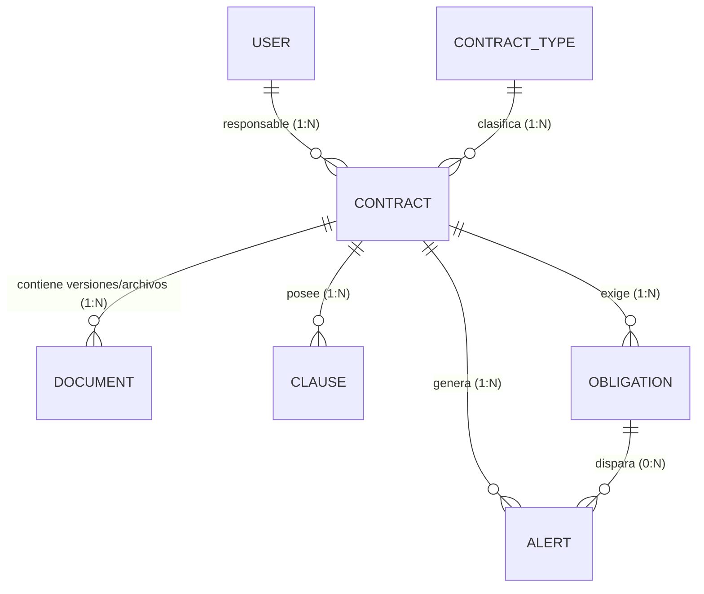

# ⚖️ LegalDocs — Organizador Inteligente de Contratos (IA + RAG + n8n)

**LegalDocs** es una plataforma web empresarial diseñada para registrar, organizar, analizar y consultar contratos corporativos mediante Inteligencia Artificial, bases de datos vectoriales y automatización de alertas.

> **Alcance del sistema:** LegalDocs es una herramienta de organización, trazabilidad y consulta documental asistida por IA. No emite conceptos ni dictámenes jurídicos definitivos.

---

## 🚀 Características Principales

* **Gestión Integral de Contratos:** CRUD completo, clasificación por tipo contractual, control de estados (`ACTIVE`, `EXPIRING_SOON`, `EXPIRED`, `TERMINATED`), responsables y observaciones.
* **Procesamiento Automático de PDF con IA:** Extracción de texto por página mediante **Apache PDFBox**, clasificación automática, generación de resumen ejecutivo e identificación estructurada de cláusulas y obligaciones con **Spring AI**.
* **Indexación Vectorial Real en Qdrant:** Fragmentación (*chunking*) inteligente de documentos e indexación de cláusulas con metadatos relacionales (`contract_id`, `clause_category`, `page_number`).
* **Sistema RAG (Retrieval-Augmented Generation):** Consultas en lenguaje natural sobre uno o todos los contratos, con respuestas fundamentadas exclusivamente en los fragmentos recuperados y referencias exactas (contrato, cláusula, archivo y página).
* **Automatización de Vencimientos con n8n:** Detección programada de contratos próximos a vencer (**30, 15 y 7 días**) y obligaciones pendientes (**≤ 7 días**), envío de alertas por correo electrónico y registro anti-duplicados en PostgreSQL.
* **Dashboard Ejecutivo en Tiempo Real:** Indicadores de contratos vigentes, vencidos, próximos a vencer, obligaciones pendientes e historial de alertas.

---

## 🛠️ Stack Tecnológico

| Capa | Tecnología | Uso en el Proyecto |
| :--- | :--- | :--- |
| **Backend** | Java 21 + Spring Boot 3.3.5 | API REST, lógica de negocio, validaciones y servidor de archivos estáticos. |
| **Persistencia Relacional** | PostgreSQL 16 + Spring Data JPA | Almacenamiento transaccional de usuarios, contratos, documentos, cláusulas, obligaciones y alertas. |
| **Base de Datos Vectorial** | Qdrant (`v1.11.3`) | Almacenamiento de embeddings y búsqueda por similitud semántica con filtros de metadatos. |
| **Inteligencia Artificial** | Spring AI (`1.0.0-M3`) | Generación de embeddings (`text-embedding-3-small`), extracción estructurada y motor RAG (`gpt-4o-mini`). |
| **Procesamiento PDF** | Apache PDFBox (`3.0.3`) | Extracción de texto página por página conservando numeración. |
| **Automatización** | n8n | Flujos programados (Cron/Webhook), envío de correos SMTP y confirmación vía REST. |
| **Frontend** | HTML5 + CSS3 + JavaScript (Vanilla) | Interfaz SPA ligera y responsive servida desde `src/main/resources/static`. |
| **Infraestructura** | Docker & Docker Compose | Contenerización multi-etapa, red interna, volúmenes persistentes y healthchecks. |

---

## 🗄️ Modelo Entidad-Relación (PostgreSQL)



---

## ⚙️ Instalación y Ejecución con Docker

1. Copia el archivo `.env.example` a `.env` y coloca tu `OPENAI_API_KEY`:
   ```bash
   cp .env.example .env
   ```
2. Ejecuta los contenedores:
   ```bash
   docker compose up --build -d
   ```
3. Accede a los servicios:
   * **LegalDocs App:** `http://localhost:8080` (`admin@legaldocs.com` / `admin123`)
   * **Qdrant Dashboard:** `http://localhost:6333/dashboard`
   * **n8n Automation:** `http://localhost:5678` (`admin` / `admin_n8n_pass`)
